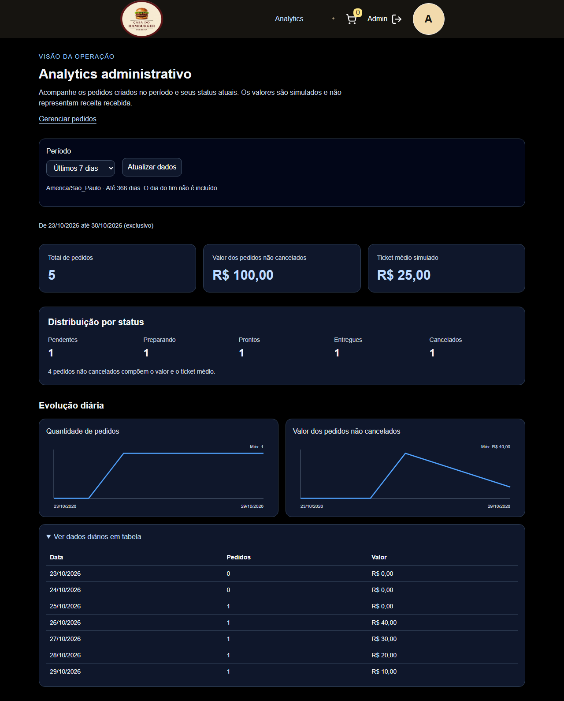
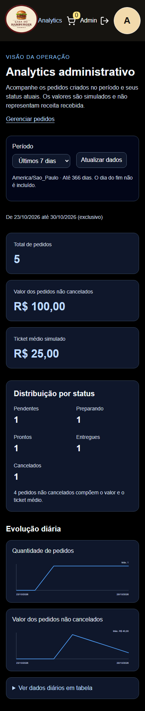

# RF-44 — Analytics administrativo

Data: 29/10/2026. Branch: `feat/RF044-admin-analytics-dashboard`.
Status: implementação em validação; RF-44 não foi marcado como concluído.

## Auditoria e escopo

Base confirmada por fetch remoto: `develop` em
`3b3657ebf1a038e01263abf7a36038d82bb3b44e`. Branch solicitada já existia,
local e remotamente, nesse commit. Workspace inicial limpo. Nenhuma mudança
não relacionada foi descartada. Nenhuma configuração Git/externa foi alterada.

Fontes inspecionadas: AGENTS, README, requisitos RF-32–50 e RNF-10/11/14/15/16/20,
seções 14/15, ADRs (especialmente 0004), schema/migrations, autenticação,
pedidos, sessão/cache, scripts, configs, hooks, template de PR e CI.

Divergências relevantes:

- RF-44 dizia “faturamento”, embora o único pagamento atual seja `SIMULATED`.
  O contrato agora distingue valor de pedidos de recebimento financeiro.
- Existem índices de usuário/status; RNF-11 não representa ausência total de índices.
  Não existe índice de `Order.createdAt`; nenhuma migration foi acrescentada sem medição.
- A configuração global do QueryClient desativa refoco/remount. O hook de analytics
  sobrescreve essas opções para revalidar dados stale, sem alterar outros módulos.
- Os caminhos de revisores citados em AGENTS/template não existem neste checkout;
  as instruções atuais estão em `.agents/skills/code-review/code-review-agent.md`.
  A revisão desta entrega usa seu checklist e as skills de review/segurança.
- Não existe CD ativo. A CI foi ampliada; não houve deploy nem alteração de branch protection.

## Contrato e arquitetura

Ver [ADR-0006](../architecture/adr/0006-dashboard-analytics-administrativo.md) e
[requisitos](../architecture/REGRAS_DE_NEGOCIO.md), contrato RF-44.

`GET /admin/analytics/summary?from=2026-10-01&to=2026-11-01`

Datas civis ISO, `[from,to)`, 1–366 dias, anos 2000–2100, fuso
`America/Sao_Paulo`. PostgreSQL converte os limites usando regras IANA.
401 sem sessão, 403 sem admin atual, 400 em filtros inválidos. Resposta
`Cache-Control: private, no-store` e DTO sem PII:

```json
{
  "period": { "from": "2026-10-01", "to": "2026-11-01", "timeZone": "America/Sao_Paulo" },
  "orders": {
    "total": 0,
    "byStatus": { "PENDING": 0, "PREPARING": 0, "READY": 0, "DELIVERED": 0, "CANCELLED": 0 },
    "nonCancelled": 0
  },
  "amounts": { "orderValueInCents": 0, "averageTicketInCents": 0 },
  "series": [{ "date": "2026-10-01", "orders": 0, "orderValueInCents": 0 }]
}
```

O exemplo abrevia a série: a resposta real contém todos os dias do intervalo.
Contagens incluem cancelados; soma e denominador do ticket excluem cancelados.
Status é o atual, agrupado pela criação, sem reconstrução de transições.
Soft delete não retira pedidos históricos. BigInt protege somas e arredondamento
inteiro do ticket; conversão JSON exige inteiros seguros.

Backend em camadas; uma consulta parametrizada agrupa no banco por dia/status.
No máximo 1.830 grupos, sem transferir pedidos individuais ao Node ou navegador.
DTO com até 366 dias. Sem alteração no schema ou regras de pedidos/pagamento.

Frontend `/admin/analytics`, acesso no header também em mobile, carregamento sob
demanda, filtros 7/30 dias e personalizado, cards, duas curvas SVG e tabela diária,
distribuição por status, skeleton, erro/retry, vazio e atualização manual.
Sem biblioteca de gráficos. Única dependência nova: Playwright, apenas em desenvolvimento.

TanStack Query privado por identidade/admin/geração/filtros, stale time de 30s,
refoco/remount e invalidação nas três mutations locais de pedidos. Axios e
sessionRequests abortam/rejeitam respostas antigas. Sem Zustand para analytics.
Mudanças de outro dispositivo aparecem ao atualizar ou refocar após stale time.

## Segurança e revisão

Revisão por negócio, RBAC, DTO, validação, concorrência de leitura, cache e CI:

- A API consulta privilégio atual no banco; token antigo com admin=true não eleva conta comum.
- SQL parametrizado, datas estritas, limite de 366 dias; erros seguem handlers existentes.
- Uma instrução fornece snapshot consistente; consulta não escreve dados.
- Não há PII, IDs de clientes ou credenciais no DTO; cookies continuam httpOnly.
- Falha de revalidação oculta métricas anteriores; 403 mostra acesso restrito.
- Seed/launcher/cleanup ficam fora de `src` e do build; nenhum endpoint de bypass.
- E2E usa login bcrypt/JWT real, contas sintéticas distintas por cenário e rate limiting real.
- Integração/E2E validam autorização temporária vinculada à conexão antes de conectar.
- CI usa PostgreSQL exclusivo do job, permissões contents:read, sem secrets de produção.
- Trace em falhas é local ao runner; artefatos publicados não incluem arquivos de trace/rede.
- Cleanup de fixtures e autorização é executado mesmo em falhas. Nenhum banco persistente foi usado.

## Evidências locais

PostgreSQL 18: instância criada exclusivamente para esta execução, em diretório
`casa-rf44-disposable-20261029` temporário e porta 55444. Database/user efetivos
`casa_security_20261028` confirmados por SQL junto ao diretório de dados antes da
autorização por SHA-256 da conexão. As 19 migrations foram aplicadas somente nela.

- Backend: `bun run test`, 13 arquivos / 103 testes aprovados (inclui integração e concorrência).
- Frontend: `bun run test:run`, 3 arquivos / 15 testes aprovados.
- Builds backend e frontend aprovados; frontend emite aviso de chunk principal >500 KB.
- Typecheck adicional de testes/backend e Playwright/frontend aprovado.
- Prisma validate aprovado; schema sem mudanças nesta feature.
- `bun audit --json`: `{}` nos dois pacotes, sem vulnerabilidades reportadas nessa consulta.
- `node scripts/check-tooling-compatibility.mjs`: aprovado.
- Quality gate completo aprovado fora do sandbox, incluindo `sh -n` do hook.
  O shell do Git falha ao iniciar dentro do sandbox (código 3221225794).
- `git diff --check`: aprovado.
- Na retomada da conversa, a instância temporária havia sido encerrada e uma repetição
  falhou por conexão recusada. Após reiniciar **o mesmo cluster descartável**, comprovar
  novamente destino/diretório e renovar a autorização vinculada, os 103 testes passaram.
  Essa falha de ambiente não foi declarada como aprovação nem motivou alterações no código.
- Playwright: nove cenários aprovados em 4,3 minutos contra build de produção e API/banco reais.
  Inclui abertura com uma requisição summary, 7/30 dias, vazio personalizado, RBAC,
  cancelamento e invalidação, logout/troca, mobile e perda de sessão.

Screenshots sintéticos da execução aprovada:





Primeira rodada de navegador detectou associação implícita do seletor e limite
real de login nas fixtures repetidas; controles passaram a usar `htmlFor/id` e
contas de teste distintas. O teste de requisições também identificou replay de
efeitos no StrictMode de desenvolvimento; a suíte agora serve build de produção,
sem HMR, mantendo o app real. Requisições a provedores/fontes externos são abortadas
no navegador de teste para não depender de serviços externos.

## Performance

Script reprodutível protegido: `back-end/tests/performance/analytics.ts`.
50.000 pedidos sintéticos distribuídos em 366 dias, dois aquecimentos e dez amostras
Supertest do endpoint completo. Mediana local 303,18 ms; p95 amostral 417,04 ms;
DTO 22.997 bytes. São medições locais sob carga das ferramentas, não SLA de produção.

EXPLAIN ANALYZE: 1.830 grupos, HashAggregate (217 KB), sort em memória (134 KB),
910 blocos em cache, zero temporários; execução do plano 453,10 ms. Sequential scan
leu os 50.000 registros, pois esse período selecionou todo o conjunto. Os índices
existentes de usuário/status não são adequados ao filtro temporal. Não foi criado
índice para uma consulta que seleciona todos os registros; avaliar `createdAt` com
carga e seletividade reais se a operação crescer.

Pelo caminho de código, cada summary faz duas consultas: uma leitura de autorização
por ID e uma agregação. Não há N+1. A contagem é inspeção estática, não instrumentação
de queries. Gráficos e tabela são limitados a 366 pontos/dias; tabela tem rolagem
limitada. E2E mede uma requisição summary na abertura do dashboard de produção.

## CI, operação e validação manual

Job `e2e` depende dos jobs backend/frontend, instala com lockfile congelado,
valida/gera Prisma, aplica migrations descartáveis, prepara seed, instala Chromium,
verifica tipos, inicia servidores com health checks e executa nove cenários reais.
Falha de teste falha o job; um retry no CI. Publica PNGs, JUnit e HTML por sete dias.
O Playwright encerra servidores; cleanup sempre remove dados sintéticos/autorização.

Para E2E local: preparar PostgreSQL **novo e descartável**, comprovar destino e
emitir a autorização exigida por `testDatabaseSafety.ts`. Fornecer NODE_ENV=test,
TEST_DATABASE_URL e DATABASE_URL para essa mesma conexão, sem carregar credenciais
reais. Instalar Chromium e executar `bun run test:e2e` em `front-end`.
`E2E_BASE_URL` padrão `http://127.0.0.1:5173`, restrito a loopback. Backend de teste
usa porta 3000. Não reutiliza servidores existentes. Nunca emitir autorização para
um banco persistente só para fazer a guarda passar.

Validação manual: entrar como admin, abrir Analytics no header; comparar 7/30 dias,
aplicar período sem dados, abrir tabela, cancelar um pedido pendente na gestão,
voltar e confirmar atualização; sair e entrar como usuário comum; acessar rota
restrita. Em mobile, conferir filtros, tabela, gráficos e ausência de overflow.

PR, hashes, CI e merge serão registrados após a conclusão das etapas remotas.
Não há publicação em produção nesta entrega. A configuração externa de checks
obrigatórios permanece sob controle do mantenedor.
