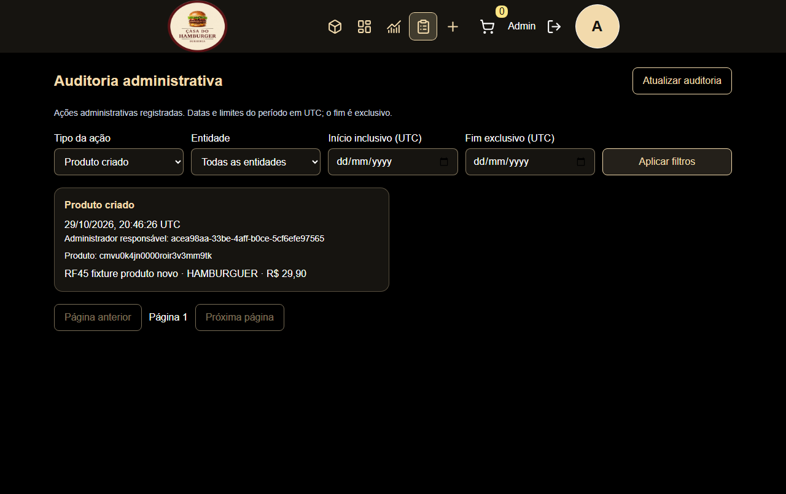
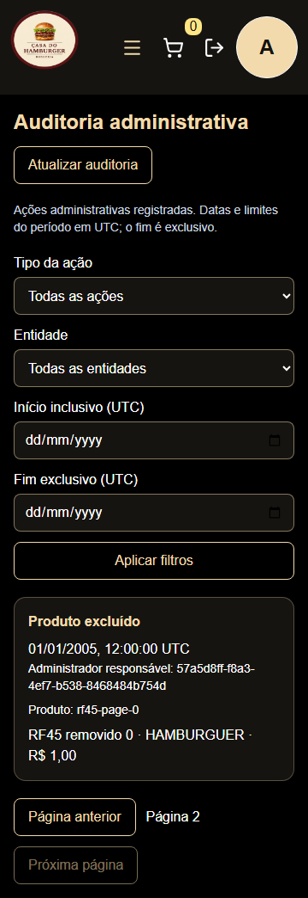

# RF-45 — Correções administrativas e auditoria persistente

Data: 29/10/2026. Branch: `feat/RF045-admin-audit-logs`.

## Fase A — diagnóstico e implementação

Workspace inicial limpo. Branch local e remota já existentes, ambas no HEAD
`007fe086041466a6cf419131b26e79ee5aebd99b`, também HEAD remoto da `develop`.
Não houve troca de branch, descarte de arquivos ou alteração de configuração Git.

- Header: navegação administrativa reutilizável, links sem controles interativos
  aninhados, nome Métricas e rota `/admin/analytics` preservada. Desktop horizontal;
  mobile usa o Sheet existente, com fechamento, foco e teclado geridos pelo Base UI.
  Carrinho e logout usam botões nomeados e alvos de pelo menos 44px.
- Pedidos: repositório, service, controller e DTO já preservavam `customerName` e
  snapshots dos itens. Não se acrescentaram colunas nem se substituiu o nome do
  cliente pelo administrador. Regressão real com duas contas verifica listagem
  administrativa, posse, IDOR e preservação após alterações de nome/preço.
  Cards usam o total explícito da API; grade adapta uma/duas/três colunas e os
  filtros quebram linha. Modal de produto usa `showModal()` e Escape nativos.
- Moeda: havia dois erros compensatórios. O schema multiplicava a entrada por
  10.000 e o helper legado dividia a apresentação por 1.000.000. Analytics dividia
  corretamente por 100, expondo valores inflados persistidos pela entrada antiga.
  A entrada agora recebe centavos inteiros; só o formulário converte reais em
  centavos. Catálogo, carrinho, pedidos e dashboard compartilham `formatCurrency`.
  Não houve migração corretiva de dados legados: seu tratamento exige auditoria
  operacional específica, incluindo a identificação dos registros afetados.

O teste de integração envia multipart `price=2990`, confere o preço gravado e o
retorno HTTP, faz checkout em duas contas, compara snapshots e consulta soma/ticket
no PostgreSQL. A agregação mantém ADR-0006: conta cancelados, exclui-os do valor
e do denominador do ticket, com arredondamento inteiro e pagamento simulado.
Seeds de RF-44 usam centavos coerentes; não foi necessária conversão de fixtures.

## Ambiente e evidências de validação

PostgreSQL 18 criado exclusivamente para esta tarefa, porta 55445, diretório
temporário `casa-rf45-disposable-20261029/data`. Banco e usuário efetivos,
endereço, porta e diretório foram confirmados por SQL. As 19 migrations da base
foram aplicadas somente nessa instância. A autorização local expira e está
vinculada ao SHA-256 da conexão; a guarda existente não foi relaxada.

As seções abaixo registram as evidências locais e a implementação RF-45;
a integração Git é acompanhada na PR da feature. Nenhum banco persistente,
credencial de produção, deploy ou configuração externa foi alterado.

### Aceite da Fase A

- Frontend: 6 arquivos / 34 testes aprovados; build e typecheck E2E aprovados.
- Backend: 113 testes aprovados na primeira rodada; a nova regressão falhou por
  ausência do claim `iat` na fixture e passou após a correção. Build e typecheck
  adicional dos testes aprovados. A execução integral será repetida com RF-45.
- Quality gate completo aprovado: lint/formatação dos dois pacotes, arquivos
  compartilhados e sintaxe do hook. `git diff --check` e parser Markdown aprovados.
- Playwright: 19 cenários aprovados em 5,4 minutos. Navegação e pedidos em 360,
  375, 390, 430, 767, 768, 1024 e 1440px; Escape, clique externo, retorno de foco,
  permissões, cancelamento/invalidação, filtros, troca e expiração de sessão.
- Rodada anterior do navegador foi invalidada por um build concorrente que
  substituiu os arquivos servidos. Foi encerrada e repetida com build estável;
  as falhas dessa rodada não foram ocultadas nem atribuídas ao produto.
- `bun audit --json`: `{}` nos dois pacotes; check de compatibilidade da CLI aprovado.
- Avisos preexistentes: chunk principal acima de 500 kB e depreciação de consultas
  concorrentes do adapter `pg`. Não foram relaxadas configurações para silenciá-los.

## RF-45 — implementação

Arquitetura e política: [ADR-0007](../architecture/adr/0007-auditoria-administrativa-persistente.md).
Migration aditiva: `20261029203000_add_admin_audit_log`. Acrescenta `AuditLog`, dois
Enums e quatro índices; não converte dados existentes, não adiciona cascatas e não
muda colunas de clientes/produtos/pedidos. Aplicada e validada no banco descartável.
Prisma Client gerado com a versão instalada 7.10.1, sem trocar dependências.

Eventos: `PRODUCT_CREATED`, `PRODUCT_DELETED`, `ORDER_STATUS_CHANGED` e
`ORDER_CANCELLED`. Cancelamento administrativo via PATCH ou POST registra somente
cancelamento; cancelamento por cliente continua fora da auditoria administrativa.
Criação/exclusão/status e INSERT do evento usam o mesmo TransactionClient.
CAS continua rejeitando conflito em 409; repetição inválida não gera sucesso.

Ator e requestId não vêm do body. `requireAuth` verifica conta/privilégio atual;
contexto HTTP gera UUID. Produto registra nome/categoria/preço; pedido, somente
status. DTO reaplica a lista permitida. Não copia perfil, e-mail, cliente, imagem,
chaves Cloudinary, senha, cookie ou token. Responsável aparece por ID estável,
sem FK, preservado depois da exclusão da conta. API comum é append-only; acesso
privilegiado ao banco permanece um limite documentado.

### API e interface

`GET /admin/audit-logs` aceita `action`, `entityType`, `entityId`, `actorId`,
`from`/`to` ISO UTC (`[from,to)`, até 366 dias), `limit` (1–100, padrão 20) e
`cursor`. Resposta: `{ items, nextCursor }`; cada item contém `id`, `actorId`,
`action`, `entityType`, `entityId`, `before`, `after`, `requestId`, `createdAt` ISO.
Ordenação descendente por `(createdAt,id)`, com desempate e cursor composto.
Não oferece contagem global nem rotas públicas de escrita. 401 sem sessão,
403 sem admin atual, 400 em filtros inválidos e `private, no-store` nas respostas.

Página `/admin/audit-logs`, carregada sob demanda e acessível pelo header desktop
ou Sheet mobile. Filtros com rótulos explícitos, limites UTC, lista de resumos,
responsável, entidade, data/hora, paginação anterior/próxima, loading/vazio/erro
com nova tentativa. Erro/403 oculta dados antigos. TanStack Query segrega usuário,
admin, geração e filtros; Axios rejeita respostas de outra sessão. Mutações
administrativas invalidam o prefixo de auditoria. Não usa Zustand para eventos.

### Testes e CI

- Backend: 17 arquivos / 145 testes aprovados em execução integral isolada,
  incluindo 82 unitários e 63 de integração. A primeira execução concorrente com
  frontend atingiu 5s em um teste antigo de login; repetida sem essa carga, passou.
  Nenhum timeout/regra foi ampliado. Typecheck de runtime e testes aprovado.
- RF-45: 11 casos de integração, incluindo exclusão concorrente e falha real do
  INSERT por trigger temporária. A trigger é removida em `finally`. Verificou-se
  rollback de criação, exclusão e status, sem evento de sucesso em falhas.
- Frontend: 7 arquivos / 39 testes aprovados; repetição dos cinco testes da página
  aprovou após tornar explícitos os rótulos. Build e typechecks dos testes fazem
  parte das verificações. Os resultados de navegador estão registrados abaixo.
- Suítes existentes receberam limpeza da tabela de eventos em seu teardown,
  dentro da guarda de banco descartável. Seeds E2E limpam somente contas/eventos
  sintéticos e produtos com prefixo reservado. Não há bypass de autenticação.
- Launcher E2E substitui somente upload Cloudinary e envio Resend; login bcrypt,
  JWT, validação binária, services, transações e PostgreSQL são reais. Navegador
  bloqueia hosts externos. Fixtures de 21 eventos verificam paginação real.
- CI preserva backend/frontend/E2E, instalação congelada, guardas, migrations e
  verificações existentes. Acrescenta auditoria de dependências altas/críticas
  nos pacotes e atualiza o nome do artefato de evidências. Não há CD ativo.

### Limites operacionais

Não houve migração em banco persistente, deploy, mudança de infraestrutura,
credenciais ou proteção de branch. Retenção definida em 365 dias; expurgo e
backups exigem rotina operacional separada. Não há imutabilidade absoluta nem
rollback distribuído com Cloudinary: falha posterior ao upload pode deixar
imagem órfã. Notificação por e-mail ocorre após commit e continua best-effort.
Dados monetários legados não foram alterados; a identificação e eventual correção
por registro dependem de auditoria operacional, sem divisão indiscriminada dos
valores existentes. O pagamento continua simulado.

### Resultado final local de navegador e revisão

Os seis cenários RF-45 passaram em 3,6 minutos após explicitar `htmlFor`/`id` nos
filtros. A rodada anterior aprovou cinco e falhou ao localizar o seletor por
rótulo exato; a correção foi coberta também no teste de componente. A Fase A já
havia aprovado 19 cenários (incluindo os oito viewports). A CI executa os 25
cenários juntos sobre o mesmo código submetido, com banco exclusivo do job.

Revisão local feita pelos checklists de negócio, segurança, testes, API e React
em `.agents/skills/code-review/code-review-agent.md` e nas skills aplicáveis.
Não houve subagente ou revisão humana independente. Verificados: DTOs e lista
permitida, ausência de API de escrita de eventos, autorização atual e IDOR,
rollback real/CAS, índices/cursor, cache privado, contratos em centavos e diff
integral. Nenhum bloqueador conhecido permaneceu na implementação local.

Quality gate executado diretamente e novamente por cada commit: lint e Prettier
dos dois pacotes, arquivos compartilhados e `sh -n` do hook. Falhas de formatação
impediram commits e foram corrigidas; o hook não foi ignorado. Prisma validate,
builds, typechecks de runtime/testes/E2E, parser Markdown e `git diff --check`
aprovados. Auditoria local de dependências retornou `{}` em ambos os pacotes.
Manifestos/lockfiles não mudaram. Os avisos de chunk >500 kB e depreciação `pg`
continuam documentados, sem redução de regras.

### Git e CI remota

Commits separados para moeda, UI responsiva, regressão de pedidos, ADR/contrato,
backend/migration, frontend, testes/CI e evidências finais. Staging seletivo e
hooks preservados; sem force push, sem push direto em `develop` e sem mudança de
configuração Git. Publicação, checks e decisão de merge são informados na PR e
no relatório final da execução. A branch de feature não deve ser excluída.

Não foi possível ler os detalhes administrativos da proteção de `develop` pelo
conector GitHub (403). A leitura normal confirma `protected=true`; nenhuma regra
foi alterada. Merge exige checks finais aprovados e estado de merge permitido,
sem contornar bloqueios ou aprovações. Não há workflow ativo de CD/deploy.
