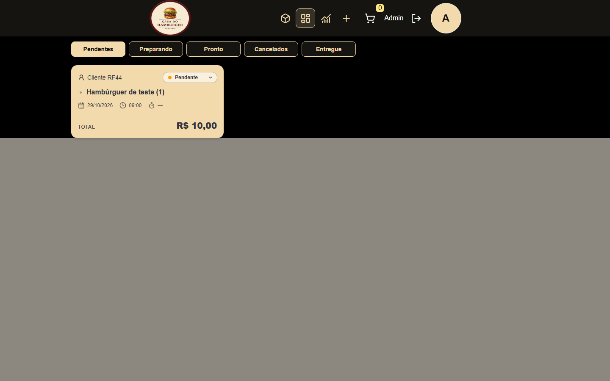

# RF-45 — Correções administrativas e auditoria persistente

Data: 29/10/2026. Branch: `feat/RF045-admin-audit-logs`.

## Fase A — diagnóstico e implementação

Workspace inicial limpo. Branch local e remota já existentes, ambas no HEAD
`007fe086041466a6cf419131b26e79ee5aebd99b`, também HEAD remoto da `develop`.
Não houve troca de branch, descarte de arquivos ou alteração de configuração Git.

- Header: navegação administrativa reutilizável, links sem controles interativos
  aninhados, nome Métricas e rota `/admin/analytics` preservada. Desktop horizontal;
  mobile usa o Sheet existente, com fechamento, foco e teclado geridos pelo Base UI.
  Carrinho e logout usam botões nomeados e alvos de pelo menos 44px.
- Pedidos: repositório, service, controller e DTO já preservavam `customerName` e
  snapshots dos itens. Não se acrescentaram colunas nem se substituiu o nome do
  cliente pelo administrador. Regressão real com duas contas verifica listagem
  administrativa, posse, IDOR e preservação após alterações de nome/preço.
  Cards usam o total explícito da API; grade adapta uma/duas/três colunas e os
  filtros quebram linha. Modal de produto usa `showModal()` e Escape nativos.
- Moeda: havia dois erros compensatórios. O schema multiplicava a entrada por
  10.000 e o helper legado dividia a apresentação por 1.000.000. Analytics dividia
  corretamente por 100, expondo valores inflados persistidos pela entrada antiga.
  A entrada agora recebe centavos inteiros; só o formulário converte reais em
  centavos. Catálogo, carrinho, pedidos e dashboard compartilham `formatCurrency`.
  Não houve migração corretiva de dados legados: seu tratamento exige auditoria
  operacional específica, incluindo a identificação dos registros afetados.

O teste de integração envia multipart `price=2990`, confere o preço gravado e o
retorno HTTP, faz checkout em duas contas, compara snapshots e consulta soma/ticket
no PostgreSQL. A agregação mantém ADR-0006: conta cancelados, exclui-os do valor
e do denominador do ticket, com arredondamento inteiro e pagamento simulado.
Seeds de RF-44 usam centavos coerentes; não foi necessária conversão de fixtures.

## Ambiente e evidências de validação

PostgreSQL 18 criado exclusivamente para esta tarefa, porta 55445, diretório
temporário `casa-rf45-disposable-20261029/data`. Banco e usuário efetivos,
endereço, porta e diretório foram confirmados por SQL. As 19 migrations da base
foram aplicadas somente nessa instância. A autorização local expira e está
vinculada ao SHA-256 da conexão; a guarda existente não foi relaxada.

Resultados finais, evidências de navegador, RF-45 e integração Git serão
registrados ao término das etapas correspondentes. Nenhum banco persistente,
credencial de produção, deploy ou configuração externa foi alterado.

### Aceite da Fase A

- Frontend: 6 arquivos / 34 testes aprovados; build e typecheck E2E aprovados.
- Backend: 113 testes aprovados na primeira rodada; a nova regressão falhou por
  ausência do claim `iat` na fixture e passou após a correção. Build e typecheck
  adicional dos testes aprovados. A execução integral será repetida com RF-45.
- Quality gate completo aprovado: lint/formatação dos dois pacotes, arquivos
  compartilhados e sintaxe do hook. `git diff --check` e parser Markdown aprovados.
- Playwright: 19 cenários aprovados em 5,4 minutos. Navegação e pedidos em 360,
  375, 390, 430, 767, 768, 1024 e 1440px; Escape, clique externo, retorno de foco,
  permissões, cancelamento/invalidação, filtros, troca e expiração de sessão.
- Rodada anterior do navegador foi invalidada por um build concorrente que
  substituiu os arquivos servidos. Foi encerrada e repetida com build estável;
  as falhas dessa rodada não foram ocultadas nem atribuídas ao produto.
- `bun audit --json`: `{}` nos dois pacotes; check de compatibilidade da CLI aprovado.
- Avisos preexistentes: chunk principal acima de 500 kB e depreciação de consultas
  concorrentes do adapter `pg`. Não foram relaxadas configurações para silenciá-los.

